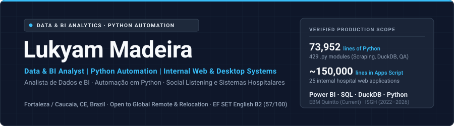

  

 

&nbsp;&nbsp;

---

### Verified Tech Stack · Tecnologias Reais

**Data & BI**

  
  
  
  
  
  

 

**Programming & Automation**

  
  
  
  
  
  
  
  
  
  

 

**Engineering, CI & AI Governance**

  
  
  

---

## English

**Data & BI Analyst | Python Automation | Social Listening & Healthcare Systems**
Caucaia, CE, Brazil (Open to Global Remote or Relocation) · [Certified B2 English (EF SET 57/100)](https://cert.efset.org/h9qN5K)

Systems Analysis and Development graduate (May 2026) with 4+ years of experience building executive BI dashboards, data extraction pipelines, and internal web/desktop applications. Currently working as a **BI, Data Intelligence & Automation Analyst at EBM Quintto** (previously 4+ years in Healthcare Quality & Patient Safety at **ISGH**).

#### Public Case Study (Open Repository)

- **[Healthcare Quality & Patient Safety BI Case Study (`healthcare-quality-bi-analytics`)](https://github.com/Lukyammm/healthcare-quality-bi-analytics)**: End-to-end BI portfolio project built on a **100% synthetic hospital dataset**:
  - Star-schema dimensional model (`dim_unit`, `dim_safety_target`, `fact_safety_walks`, `fact_notifications`) documented in [`data_model.md`](https://github.com/Lukyammm/healthcare-quality-bi-analytics/blob/main/data_model.md)
  - SQL DDL schema, clinical KPI queries, and automated data quality checks (`schema.sql`, `kpi_queries.sql`, `data_quality_checks.sql`)
  - Power BI DAX measure catalog (`powerbi_measures.dax`) covering compliance rate, target gap, SLA response rate, and unit risk priority score

#### Production Systems & Internal Tools (Private Repositories)

*The systems below run in internal agency or hospital environments and are kept in private repositories for client/institutional governance. Architecture overviews and sanitized code walkthroughs are available during technical interviews.*

**1. BI, Social Listening & Python Automation (73,952 lines across 429 `.py` modules):**
- **RASP — Social Media Scraping & Listening Engine (`23,270 lines` · 157 `.py` modules):** Proprietary Python + Playwright engine with persistent session management and local REST API (`127.0.0.1:8000`) for multi-platform social data extraction (Instagram, TikTok, Facebook, YouTube, X).
- **EBM BI Hub / DashboardEBM (`9,832 lines` · 52 `.py` modules):** Python, Flask, and DuckDB desktop analytics hub (packaged via PyInstaller) integrating Zeeng API metrics, social scrapes, automated press clipping, and audited Excel/PowerPoint generation across 8 major public and private sector accounts.
- **EBM Report Guide (`6,914 lines` · 50 `.py` modules):** CustomTkinter desktop application guiding recurring 10-to-11-step BI reporting pipelines with automated file and mathematical QA verification.
- **Dominação IA / Matéria — Multimodal Extraction Pipeline (`32,304 lines` · 158 `.py` modules):** Automated media ingestion, video frame OCR, source-verified JSON cataloging, and multi-format compilation (HTML, Markdown, PDF, XLSX).
- **AI Governance & Project Kit (`1,632 lines` · 12 `.py` modules):** Deterministic Python hooks (`guarda.py`, `mudancas.py`, `protecao.py`, `conferir_citacoes.py`) enforcing file protection, citation verification, and automated change logs.

**2. Healthcare Operations & Quality Web Apps (~150,000 lines across 25 functional internal apps at ISGH):**
- **Locker & Custody Workflow (`30,130 lines`):** Hospital locker allocation, visitor/companion tracking, liability terms, and session auditing.
- **Hospital Room Scheduling System (`27,372 lines`):** Room booking, shift rosters, access control, and utilization logs.
- **Rapid Response Triage Platform — TRR (`9,537 lines`):** Clinical/surgical emergency triage using MEWS criticality scoring, SLA tracking, and salted password hashing with lockout protection.
- **Clinical Operations Command Center — SIGEP (`9,313 lines`):** Process governance and hospital KPI tracking with historical snapshots, RBAC, and Node.js CI test suite.
- **Patient Safety Analytics — Boletim COSEP (`8,235 lines`):** Incident notification consolidation, safety walkarounds, goal tracking, and automated email alerts.

<a href="#top">Back to top</a>

---

## Português (PT-BR)

**Analista de Dados e BI | Automação em Python | Social Listening & Sistemas Operacionais**
Caucaia, CE, Brasil (Disponível para Remoto Global ou Mudança) · [Inglês B2 Certificado (EF SET 57/100)](https://cert.efset.org/h9qN5K)

Tecnólogo em Análise e Desenvolvimento de Sistemas (concluído em mai/2026) com mais de 4 anos de experiência construindo painéis executivos de BI, pipelines de extração de dados e aplicações internas (web e desktop). Atualmente atuo como **Analista de BI, Inteligência de Dados e Automação na EBM Quintto** (anteriormente, mais de 4 anos na Gestão da Qualidade e Segurança do Paciente no **ISGH**).

#### Case Público de Portfólio (Repositório Aberto)

- **[Healthcare Quality & Patient Safety BI Case Study (`healthcare-quality-bi-analytics`)](https://github.com/Lukyammm/healthcare-quality-bi-analytics)**: Projeto completo de BI construído sobre base hospitalar **100% sintética**:
  - Modelagem dimensional Star Schema (`dim_unit`, `dim_safety_target`, `fact_safety_walks`, `fact_notifications`) documentada em [`data_model.md`](https://github.com/Lukyammm/healthcare-quality-bi-analytics/blob/main/data_model.md)
  - Scripts SQL de criação de schema, apuração de KPIs clínicos e verificação automatizada de qualidade de dados (`schema.sql`, `kpi_queries.sql`, `data_quality_checks.sql`)
  - Catálogo de medidas DAX para Power BI (`powerbi_measures.dax`) cobrindo taxa de conformidade, gap contra meta, SLA de resposta e escore de priorização de risco por unidade

#### Sistemas em Produção e Ferramentas Internas (Repositórios Privados)

*Os sistemas abaixo operam em ambiente interno de agência ou hospitalar e permanecem em repositórios privados por governança institucional. Demonstrações de arquitetura e código saneado estão disponíveis em entrevistas técnicas.*

**1. BI, Social Listening e Automação em Python (73.952 linhas em 429 módulos `.py`):**
- **RASP — Motor de Coleta e Social Listening (`23.270 linhas` · 157 módulos `.py`):** sistema próprio em Python + Playwright com gerenciamento persistente de sessões e API REST local (`127.0.0.1:8000`) para extração autenticada de redes sociais (Instagram, TikTok, Facebook, YouTube e X).
- **EBM BI Hub / DashboardEBM (`9.832 linhas` · 52 módulos `.py`):** aplicação analítica em Python, Flask e DuckDB (empacotada via PyInstaller) integrando métricas da API Zeeng, coletas de redes, automação de clipping de imprensa e geração auditada de planilhas e apresentações para 8 contas públicas e privadas.
- **EBM Report Guide (`6.914 linhas` · 50 módulos `.py`):** aplicação desktop em CustomTkinter que guia fluxos recorrentes de BI (10 a 11 etapas) com conferência automática de arquivos e fechamento matemático em 100%.
- **Dominação IA / Matéria — Pipeline de Extração Multimodal (`32.304 linhas` · 158 módulos `.py`):** coleta automatizada de mídia, OCR de quadros de vídeo, catalogação JSON com verificação estrita contra a fonte e geração automática de HTML, Markdown, PDF e XLSX.
- **Kit de Governança para Projetos com IA (`1.632 linhas` · 12 módulos `.py`):** ganchos determinísticos em Python (`guarda.py`, `mudancas.py`, `protecao.py`, `conferir_citacoes.py`) para proteção de fontes, auditoria de citações e registro automático de mudanças.

**2. Aplicações Web de Operações e Qualidade Hospitalar (~150.000 linhas em 25 web apps funcionais no ISGH):**
- **Gestão de Custódia e Armários (`30.130 linhas`):** controle de armários, visitantes, acompanhantes, termos de responsabilidade e auditoria de sessões.
- **Agendamento e Monitoramento de Salas (`27.372 linhas`):** alocação de salas hospitalares, escalas de turnos, controle de acesso e logs de ocupação.
- **Plataforma de Triagem do Time de Resposta Rápida — TRR (`9.537 linhas`):** abertura e priorização de chamados clínicos/cirúrgicos por escore MEWS, controle de SLA e autenticação com hash e salt.
- **Centro de Comando de Operações Clínicas — SIGEP (`9.313 linhas`):** governança de processos e KPIs hospitalares com snapshots históricos, RBAC e testes automatizados em Node.js/CI.
- **Painel de Segurança do Paciente — Boletim COSEP (`8.235 linhas`):** consolidação de notificações de incidentes, rondas de segurança, metas e alertas por e-mail.

<a href="#top">Voltar ao topo</a>

---

### Contato · Contact

  
  
  

